<picture>
  <source media="(max-width: 600px) and (prefers-color-scheme: dark)" srcset="./assets/profile/header-dark-mobile.svg" />
  <source media="(max-width: 600px)" srcset="./assets/profile/header-light-mobile.svg" />
  <source media="(prefers-color-scheme: dark)" srcset="./assets/profile/header-dark.svg" />
  
</picture>

<a href="https://www.curseforge.com/members/kltyton/projects">CurseForge</a> · <a href="https://modrinth.com/user/kltyton">Modrinth</a> · <a href="https://github.com/kltyton?tab=repositories">GitHub</a>

  

<picture>
  <source media="(max-width: 600px) and (prefers-color-scheme: dark)" srcset="./assets/profile/stack-dark-mobile.svg" />
  <source media="(max-width: 600px)" srcset="./assets/profile/stack-light-mobile.svg" />
  <source media="(prefers-color-scheme: dark)" srcset="./assets/profile/stack-dark.svg" />
  
</picture>

 

<a href="https://www.curseforge.com/members/kltyton/projects">
  <picture>
    <source media="(max-width: 600px) and (prefers-color-scheme: dark)" srcset="./assets/profile/downloads-dark-mobile.svg" />
    <source media="(max-width: 600px)" srcset="./assets/profile/downloads-light-mobile.svg" />
    <source media="(prefers-color-scheme: dark)" srcset="./assets/profile/downloads-dark.svg" />
    
  </picture>
</a>

<picture>
  <source media="(max-width: 600px) and (prefers-color-scheme: dark)" srcset="./assets/profile/footer-dark-mobile.svg" />
  <source media="(max-width: 600px)" srcset="./assets/profile/footer-light-mobile.svg" />
  <source media="(prefers-color-scheme: dark)" srcset="./assets/profile/footer-dark.svg" />
  
</picture>
